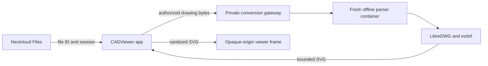

# CADViewer for Nextcloud

[](COPYING)
[](https://nextcloud.com/)
[](CHANGELOG.md)

Open **DWG and DXF drawings directly in Nextcloud Files**, with an English interface and privately installed drawing fonts, including legacy Persian SHX lettering.

**The entire application is free and open source.** No commercial SDK, paid activation, subscription, trial period or cloud conversion API is required. The project name is **CADViewer**. This is an independent project derived from the AGPL Nextcloud integration; it is not the commercial CADViewer SDK and is not affiliated with its vendor.

> **Alpha software:** `0.1.0-alpha.2`. Local integration, access-control, browser and real drawing conversion checks pass. CAD format fidelity varies; validate important drawings against the original CAD application. This repository does not claim universal AutoCAD compatibility or a complete security audit.

## Features

- Open DWG/DXF by clicking a file in Nextcloud Files.
- Zoom, pan, fit, drawing layers, model/paper layouts, monochrome display and a lineweights toggle.
- Approximate two-point measurement using drawing units.
- Existing Nextcloud file permissions, including read-only shares; access is checked again after conversion.
- English interface throughout. Persian text support applies to the drawing, not the application language.
- SHX/TrueType font lookup, extensionless-name resolution and non-fatal font substitution in a private worker directory.
- Shared SVG block definitions keep repeated floor plans compact without flattening every copy.
- Carefully scoped recovery of legacy NASKHD byte glyphs; original drawings and fonts are never rewritten.
- Offline, unprivileged conversion jobs with explicit resource limits and an isolated browser frame.

## Compatibility

| Component | Current target |
| --- | --- |
| Nextcloud | 35; integration tested with 35.0.2 |
| PHP | 8.3–8.5; reviewed security baseline: 8.3.36+, 8.4.27+, 8.5.12+ |
| App ID | `cadviewer_nextcloud` — separate from the commercial integration |
| Drawing formats | DWG → LibreDWG → DXF; DXF → ezdxf → SVG |
| Converter | LibreDWG 0.14; ezdxf 1.4.5 |
| Worker | Linux x86_64, dedicated unprivileged account, rootless Podman, cgroup v2 |
| Interface | English |

The app is installed in its own persistent custom-apps directory. It does **not** edit Nextcloud core, `.htaccess`, global MIME mappings, filecache entries, or an AIO image. Its independent app ID prevents an update to the original commercial app from replacing this package.

## How it works



The worker receives one drawing and read-only fonts. It has no access to the Nextcloud data volume, user sessions, gateway secret, host container socket, or network. The gateway token authenticates the private service; it is **not a license key**. Nextcloud stores it encrypted in this app's settings.

## Installation

Start with [the deployment guide](docs/DEPLOYMENT.md). The two components are:

1. **Nextcloud app:** install the repository's app files in `custom_apps/cadviewer_nextcloud`, enable normally, and configure Administration → CADViewer.
2. **Conversion worker:** build the pinned worker image, install the gateway under a dedicated unprivileged account, stage the required fonts privately, and configure a private endpoint ending in `/convert`.

Do not put the worker inside the AIO Nextcloud container. Do not mount a Docker or Podman socket into the parser. The guide includes OpenRC/Alpine considerations, resource limits, token handling, upgrades and rollback.

## Building

```sh
# Frontend: Node 24+, npm, bubblewrap and systemd user scopes
npm ci --ignore-scripts
bash scripts/build-isolated.sh

# Worker: Linux x86_64, Python 3.14 and rootless Podman
bash scripts/build-worker.sh
```

Downloads come from official registries/releases. LibreDWG source and Python wheel hashes are pinned. Compilation and dependency installation run offline with bounded writable scratch. See [architecture](docs/ARCHITECTURE.md) and [third-party notices](THIRD_PARTY_NOTICES.md).

For fonts and Persian-specific behavior, read [drawing fonts](docs/FONTS.md). User fonts and public test drawings are not redistributed in this repository.

## Testing and current evidence

```sh
bash scripts/test-nextcloud.sh
bash scripts/test-worker.sh
bash scripts/test-fixtures.sh
```

The private font/fixture tests require locally staged inputs; see [validation](docs/VALIDATION.md). Browser checks use a disposable Nextcloud instance and independently rendered fixture outputs. Those checks are distinguished from a deployed gateway acceptance test. No production server is targeted by the test scripts.

## Limitations

This is a **2D previewer**, not a CAD editor. DWF, DGN, ACIS/3D solids, external references/images, annotations, comparison, PDF export, public-share previews and full-text search are not implemented. Unsupported entities may be omitted. Measurements are approximate point selections and depend on the units saved in the drawing.

Modern Arabic/Persian shaping, all KATEB variants and SHX bigfonts are not universally verified. Missing fonts can alter appearance. A successful conversion is not proof that every entity matches AutoCAD. See [font notes](docs/FONTS.md) and the [validation record](docs/VALIDATION.md).

## Contributing, security and license

- [Contributing](CONTRIBUTING.md): development workflow, tests and review boundaries.
- [Security](SECURITY.md): trust boundaries and responsible reporting.
- [Changelog](CHANGELOG.md): release status and changes.
- [Upstream attribution](UPSTREAM.md): provenance and changes from the original integration.
- [AGPL-3.0-or-later](COPYING): application license. LibreDWG and other dependencies retain their own open-source licenses.

Maintained by [Amir Zalaghi](https://github.com/zalaghi). Original Nextcloud integration authors: Casper Harnung, Kevin Wamba and Zoran Miladinovic. Required copyright and license notices are retained. If you operate a modified AGPL version for network users, make its corresponding source available to them.
